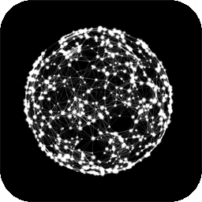

# Agent-Heart

**原生动效 Windows 壁纸** —— 把 three.js 桌面动效完整移植为纯原生程序：零 HTML、零 WebView、零第三方运行时，全部跑在 Win32 + Direct2D + Windows.UI.Composition 合成管线里。



## 特性

- **768 粒子球体 + 实时连线网**：三层粒子加色发光、K=12 近邻连线随粒子每帧重连、背向压暗，60fps 满帧渲染
- **完整交互**：鼠标拖拽旋转（带轨道阻尼）、悬停汇聚形变 + 相机飞行、点击四环互换 + 焦点虚化、滚轮倒放
- **设置界面**：托盘右键 → 设置，可调 **动效开关 / 球形大小 / 点击效果 / 鼠标拖尾**，改动即时生效并持久化
- **桌面级集成**：窗口挂在桌面图标之下（不遮挡图标、不进任务栏、不抢焦点），托盘常驻，支持开机自启
- **零依赖**：不修改注册表系统项、不替换 explorer、不依赖浏览器；退出即恢复普通桌面
- **自带安装向导**：Setup.exe 支持选择安装位置、开机自启、桌面/开始菜单快捷方式、一键卸载

## 下载

从 [Releases](../../releases) 获取：

| 资产 | 说明 |
|---|---|
| `Setup-1.0.0.exe` | 安装向导（推荐）：选目录、开机自启、快捷方式、可卸载 |
| `Agent-Heart.exe` | 便携版：解压即用，双击运行 |

运行后在桌面按 **Win+D** 显示桌面即可看到动效壁纸；右下角托盘图标右键可打开 **设置** 或退出。

## 使用

| 操作 | 效果 |
|---|---|
| 桌面空白处按住拖拽 | 旋转球体（带阻尼回稳） |
| 悬停球体 | 粒子汇聚形变 + 相机前飞 |
| 点击球体 | 四环互换形态，再点或滚轮下滑倒放 |
| 托盘右键 → 设置 | 动效 / 球形大小 / 点击效果 / 鼠标拖尾 |
| 托盘右键 → 退出壁纸 | 停止并恢复普通桌面 |

配置与分类数据存放在 `%LOCALAPPDATA%\Agent-Heart\`。

## 从源码构建

要求：Visual Studio Build Tools 2022 + Windows SDK（含 C++/WinRT 头）。

```bat
build.bat            :: 产出 out\Agent-Heart.exe（含图标与版本信息）
installer\build-installer.bat   :: 产出 installer\Setup.exe
scripts\verify-all.bat          :: 12 场景自动回归（截图 + 日志归档）
```

单文件编译自检：`build-one.bat src\xxx.cpp out\check_xxx`。

## 项目结构

```
Agent-Heart/
├── README.md  CHANGELOG.md  LICENSE  .gitignore
├── build.bat              # 一键构建主程序
├── build-one.bat          # 单文件编译自检
├── src/                   # C++ 源码（Win32 + D2D + Composition）
│   ├── main.cpp           # 宿主：桌面层挂载、输入中枢、托盘、设置入口
│   ├── sphere_scene.*     # 粒子球场景（N1 漂移/连线 + N2 形变/互换/相机）
│   ├── ui_overlay.*       # 抽屉/任务面板渲染（原前端功能，当前默认关闭）
│   ├── app_data.*         # 原生数据层（应用目录/任务/系统指标）
│   └── wallpaper.rc       # 图标与版本资源
├── assets/                # 图标与预览图
├── docs/                  # 移植规格（动效逐项对照原前端源码行号）
├── installer/             # 零第三方安装向导 Setup.exe
├── scripts/               # 开发与验收脚本（截图矩阵、回归套件、图标生成）
├── out/                   # 构建产物（git 忽略）
└── dist/                  # 发布打包产物（git 忽略）
```

## 文档

- [CHANGELOG.md](CHANGELOG.md) — 版本记录
- [docs/ui-port-spec.md](docs/ui-port-spec.md) — UI 层动效与交互规格（18 条动效，逐条标注原源码行号）
- [docs/scene-n2-spec.md](docs/scene-n2-spec.md) — 球体场景 N2 交互状态机规格（21 支状态机）
- [installer/README.md](installer/README.md) — 安装向导行为说明

## 许可证

[MIT](LICENSE)
